<h1>Hi 👋, I'm gde dhika pratama</h1>

A passionate frontend developer from **Lombok🏝️**

<h2>🚀 Languages and Tools I Use</h2>

<h2>🚀statistick commit</h2>

<h2>play games with me 👾</h2>

<picture data-importer="pacman">
  <source media="(prefers-color-scheme: dark)" srcset="https://raw.githubusercontent.com/gdedhikapratama29/gdedhikapratama29/pacman-output/pacman-contribution-graph-dark.svg?game=pacman">
  <source media="(prefers-color-scheme: light)" srcset="https://raw.githubusercontent.com/gdedhikapratama29/gdedhikapratama29/pacman-output/pacman-contribution-graph.svg?game=pacman">
  
</picture>
